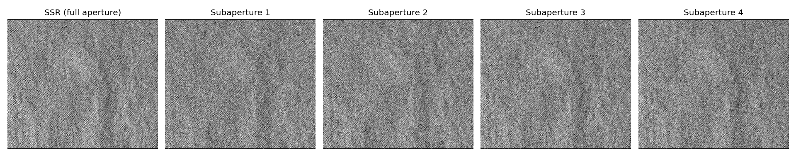

# sar-subaperture-decomposition

Re-implementation of the subaperture decomposition preprocessing of Ristea et al. (2022) for Sentinel-1 wave-mode (WV) SLC imagettes, written in September 2025 as a study of the paper. This is not the authors' code.

Each complex imagette is split into 4 intensity images, each built from a quarter of the azimuth (Doppler) spectrum, as multi-channel input for ocean pattern models.



*SSR image and its 4 subapertures (dB) for imagette `-001` of `S1C_WV_SLC__1SSV_20250907T201714_20250907T202352_004023_007FFA_3CF9`.*

Scope is preprocessing only: the paper's classification and segmentation experiments are not reproduced, so there are no accuracy figures.

## Quick start

Download a WV SLC product from the [Copernicus Data Space Ecosystem](https://browser.dataspace.copernicus.eu) and unzip the `.SAFE` folder in `data/`.

```bash
conda create -n subaperture python=3.12 -y && conda activate subaperture
pip install -e .
python decompose.py \
    --safe data/S1C_WV_SLC__1SSV_20250907T201714_20250907T202352_004023_007FFA_3CF9.SAFE \
    --image-id s1c-wv1-slc-vv-20250907t201714-20250907t201717-004023-007ffa-001 \
    --output-dir outputs
```

This writes the subaperture stack as a `.npy` array and a figure in `outputs/`.

## Method

- Normalise the complex SLC so its intensity equals sigma0 divided by a CMOD5.N reference for a constant 10 m/s wind at 45 degrees (SSR). The phase is kept. The paper does not name the model function; CMOD5.N is my choice.
- Azimuth FFT, then compensation of the 0.75 Hamming window.
- 4 evenly spaced, non-overlapping 0.75 Hamming windows of length `N // 4`, then azimuth iFFT.
- Intensity, 10 x 10 mean filter and decimation by 10.

The [notebook](notebooks/01_subaperture_decomposition.ipynb) shows each step with intermediate figures.

## Structure

```
decompose.py    command-line entry point
subaperture/    Sentinel-1 readers, calibration, CMOD5.N, decomposition
notebooks/      step-by-step demo
figures/        teaser figure
```

## References

- N.-C. Ristea, A. Anghel, M. Datcu, B. Chapron. [Guided deep learning by subaperture decomposition: ocean patterns from SAR imagery](https://arxiv.org/abs/2204.04438). arXiv:2204.04438, 2022.
- CMOD5.N implementation from [nansencenter/openwind](https://github.com/nansencenter/openwind/blob/master/openwind/cmod5n.py) (K. F. Dagestad, NERSC).

## Author

Quentin Revillon.
